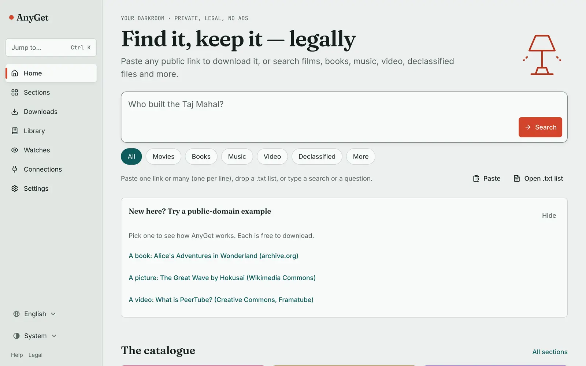
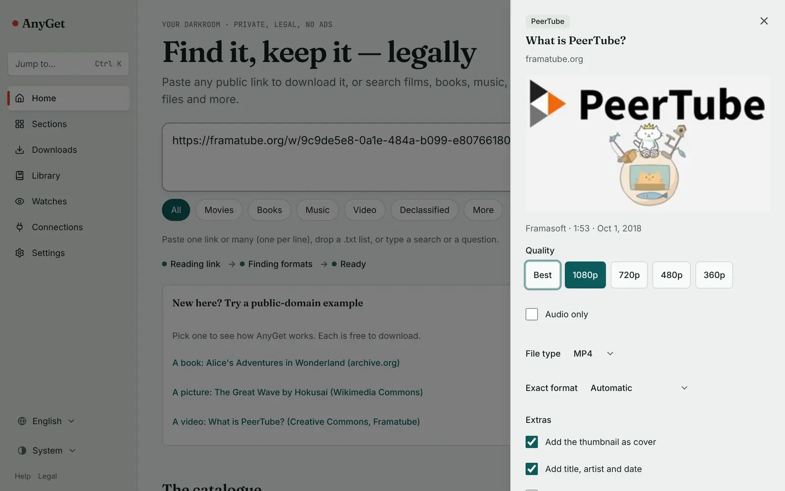
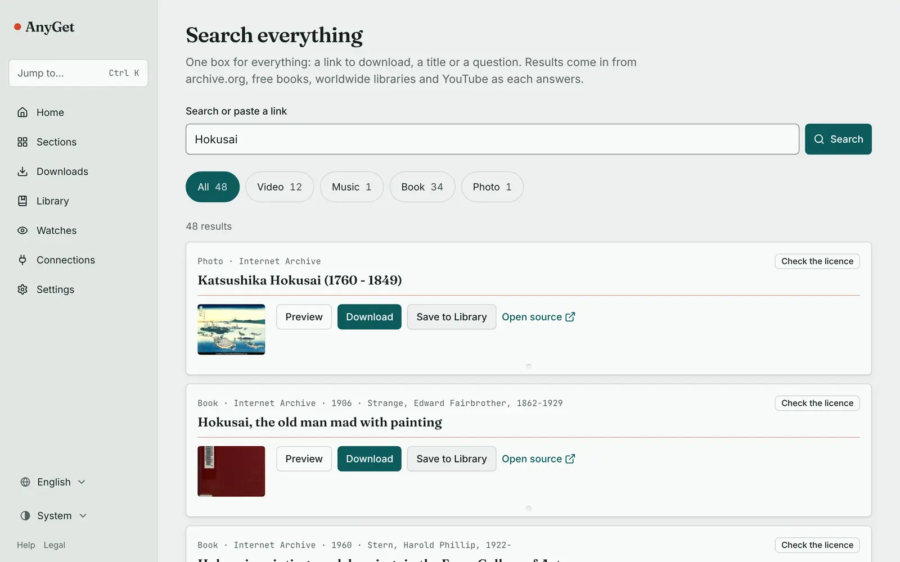
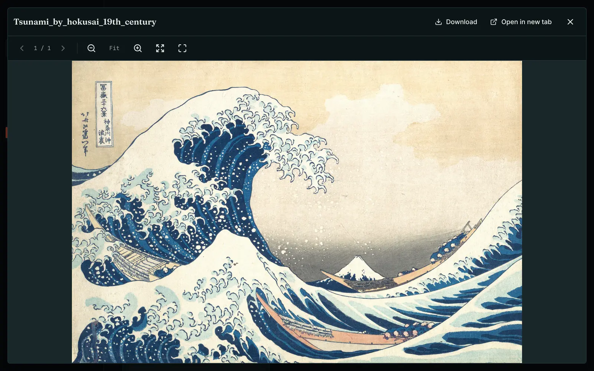
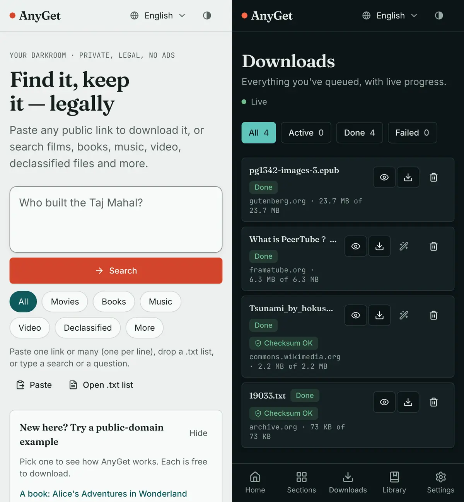

# AnyGet

[](https://github.com/saurabh29p/Downloader/actions/workflows/ci.yml)
[](LICENSE)
[](https://github.com/saurabh29p/Downloader/releases)
[](https://github.com/saurabh29p?tab=packages&repo_name=Downloader)

**Paste any public link, get the file.** Videos and audio from 1,800+ sites, archive.org and
the Wayback Machine, public-domain books, the world's libraries, code and image galleries,
all saved on your own computer, in a library you can search, read, watch and listen to.
Free and open source (MIT). No ads, no tracking, no account with us.

<picture>
  <source media="(prefers-color-scheme: dark)" srcset="docs/images/hero-dark.webp">
  
</picture>

## What it does

- **Video and audio from 1,800+ sites** (through [yt-dlp](https://github.com/yt-dlp/yt-dlp)):
  pick the quality or just the audio as MP3, with subtitles, playlists and channels.
- **archive.org and the Wayback Machine:** search items and pick the files you want, or get
  any saved version of a page or file exactly as it was captured.
- **Public-domain books, best legal copy first:** one search across Project Gutenberg,
  Standard Ebooks, Open Library, HathiTrust and national libraries. Books still in
  copyright get borrow and buy links instead.
- **The world's libraries (IIIF):** Gallica, the Library of Congress, NDL Japan, Europeana
  and more: every page at full size, or merged into one PDF.
- **An offline library:** search inside your files (even scanned PDFs after OCR), with
  previews for video, audio, PDF, EPUB, text and pictures, plus tags and duplicate finding.
- **Works on your phone:** install it like an app; on Android, share any link to it.
- **English · हिन्दी · العربية** (right to left), light and dark.

Also: code from GitHub, GitLab, Codeberg and Bitbucket; public Google Drive, Dropbox,
OneDrive and MEGA links; image galleries; Hugging Face models; **watches** that save new
uploads from a channel or collection on a schedule; a command line; a browser extension;
plugins; and an optional AI helper (everything works without it).

## What it won't do

AnyGet only downloads what you are allowed to download. It never:

- removes DRM (paid streaming, music services, paid ebooks);
- gets around paywalls, logins, members-only content, region blocks or lending limits;
- uses shadow libraries (LibGen, Z-Library, Anna's Archive and similar) or piracy sources.

When something can't be downloaded legally, AnyGet says so ("borrow only", "not available
in your region") and, for books, shows where to borrow or buy them.

## See it

| Paste a link | Search everything |
|---|---|
|  |  |
| **Read, watch and listen in your library** | **On your phone** |
|  |  |

## Quick start

You need [Docker](https://docs.docker.com/get-docker/) (on Windows, Docker Desktop with WSL2)
and Git.

```sh
git clone https://github.com/saurabh29p/Downloader.git anyget && cd anyget
cp .env.example .env     # optional: every setting is explained inside
make up                  # builds and starts AnyGet
```

Open **http://127.0.0.1:3000** and paste a link, or try one of the public-domain examples on
Home. Downloads are saved in `./downloads`; the database and settings live in `./data`.

Without `make`:

```sh
PUID=$(id -u) PGID=$(id -g) docker compose up -d --build
```

(`PUID`/`PGID` make your user the owner of the downloaded files; `make up` sets them for you.)

**Prebuilt images:** each tagged release publishes `ghcr.io/saurabh29p/anyget-api` and
`ghcr.io/saurabh29p/anyget-web` (the version and `latest`); see
[Releases](https://github.com/saurabh29p/Downloader/releases). **From source** (for
development): `make setup && make dev`. More in [docs/install.md](docs/install.md),
including Windows, macOS, Linux and Raspberry Pi.

## Use it on your phone

AnyGet runs on a computer or a small server; your phone uses it like an app.

- **Same Wi-Fi or a tunnel:** open AnyGet in your phone's browser and install it (Settings →
  Install AnyGet, or the browser menu: *Install app* on Android, *Add to Home Screen* on
  iPhone).
- **On Android**, the installed app appears in the **Share** menu: share any link to AnyGet
  to download it.
- **Away from home:** [Tailscale](docs/tailscale.md) is the easiest (no domain needed);
  [Cloudflare Tunnel + Access](docs/deploy.md) gives a web address protected by an email
  code. Either way, only you can reach it.
- **Advanced Android users** can run AnyGet in [Termux](docs/termux.md).

More in [docs/phone.md](docs/phone.md).

## Configuration

Most things are set in the app: **Settings** (downloads, AI helper, advanced options) and
**Connections** (your own accounts and free API keys, stored encrypted). Everything can also
be set in `.env`; [`.env.example`](.env.example) explains every variable in one line, and
[docs/configuration.md](docs/configuration.md) covers the important ones.

Good defaults out of the box: downloaded files are kept forever, torrents are off, and a
copy of AnyGet that is reachable from the internet refuses every request until you set an
owner sign-in ([docs/hosted.md](docs/hosted.md)).

## Keep yt-dlp up to date

Video sites change often, and most "it stopped working" problems are fixed by a newer
yt-dlp. **Settings → Advanced → yt-dlp → Check for updates** shows the installed and latest
versions. To update:

```sh
git pull && make up                                         # Docker: rebuild with the newest AnyGet
cd apps/api && uv lock --upgrade-package yt-dlp && uv sync  # from source, or before make up
```

## Backups

```sh
make backup                                   # backups/anyget-<date>.tar.gz (keep it private)
make down && make restore FILE=backups/anyget-<date>.tar.gz
```

A backup holds the database (jobs, library, watches, saved settings and keys), cookies and
the download archives, not the downloaded files themselves.

## Command line, browser extension and plugins

```sh
cd apps/api
uv run anyget get https://commons.wikimedia.org/wiki/File:Tsunami_by_hokusai_19th_century.jpg   # download (Ctrl+C pauses; run again to resume)
uv run anyget get <video link> -q 720        # a video at 720p; -x mp3 for audio only
uv run anyget search "Pride and Prejudice"   # the best legal copy of a book
uv run anyget watch list                     # scheduled watches
```

Every command is in [docs/cli.md](docs/cli.md). The **browser extension** (`make extension`;
releases attach the zips) sends the page or link you're on to your AnyGet.
**Plugins** add sites from their own Python package: see [docs/plugins.md](docs/plugins.md).

## FAQ

**A site stopped working.** Update yt-dlp first (above). If it still fails, open a
[“Site stopped working” issue](https://github.com/saurabh29p/Downloader/issues/new/choose)
with the error from the download's Details.

**YouTube asks me to sign in or says I'm a bot.** YouTube limits downloads, especially from
servers and data centres. Run AnyGet from home, or connect your own account on the
**Connections** page (a `cookies.txt` from your browser; it stays on your machine).
AnyGet never gets around members-only or paid videos.

**Where are my files?** In `./downloads` next to `docker-compose.yml` (or in
`ANYGET_DOWNLOADS_DIR` when you run from source). Every file is also in the **Library**, with
a Download button.

**Is this legal?** AnyGet is a tool, like a browser. Downloading public-domain and openly
licensed works, your own uploads, or anything a site lets you download is fine in most
places; the rules differ by country and by site. AnyGet is built not to break them: see
[What it won't do](#what-it-wont-do) and the [Disclaimer](#disclaimer).

**Can I use it from the internet?** Yes, behind a sign-in: [docs/hosted.md](docs/hosted.md)
(one hosting example), [docs/deploy.md](docs/deploy.md) (Cloudflare) or
[docs/tailscale.md](docs/tailscale.md).

More answers in [docs/troubleshooting.md](docs/troubleshooting.md).

## Documentation

[docs/README.md](docs/README.md) is the index: install, phone, configuration, the user
guide, command line, API, architecture, troubleshooting and plugins.
[CHANGELOG.md](CHANGELOG.md) lists what changed in each version.

## Contributing

Contributions are welcome: read [CONTRIBUTING.md](CONTRIBUTING.md) and the
[Code of Conduct](CODE_OF_CONDUCT.md). Found a security problem? Please follow
[SECURITY.md](SECURITY.md) and report it privately.

## Support AnyGet

AnyGet is free and has no ads. If it saves you time, you can support its development:

<!-- TODO(owner): replace the placeholders below (and in .github/FUNDING.yml) before the repository is public. -->
- GitHub Sponsors: `<github-sponsors-username>`
- Buy Me a Coffee: `<bmc-username>`
- Ko-fi: `<kofi-username>`
- Other: `<optional crypto or other donation page URL>`

Starring the repository, reporting bugs and fixing a site that broke help just as much.

## License

AnyGet is released under the [MIT License](LICENSE). It uses many other open-source
projects; see [THIRD_PARTY_NOTICES.md](THIRD_PARTY_NOTICES.md) for their licences.

## Disclaimer

- AnyGet is for personal use. Download only what you own, what is public domain or openly
  licensed, or what the site's terms allow.
- It does not and will not remove DRM, get around paywalls, logins, region blocks or
  lending limits, or use shadow libraries.
- You are responsible for what you download, and for following the law where you live and
  each site's terms.
- AnyGet is provided "as is", without warranty of any kind (see [LICENSE](LICENSE)). The
  authors are not affiliated with any site AnyGet can download from; all trademarks belong
  to their owners.

## Acknowledgements

AnyGet stands on the shoulders of [yt-dlp](https://github.com/yt-dlp/yt-dlp),
[FFmpeg](https://ffmpeg.org), [gallery-dl](https://github.com/mikf/gallery-dl),
[Deno](https://deno.com), [OCRmyPDF](https://github.com/ocrmypdf/OCRmyPDF) and
[Tesseract](https://github.com/tesseract-ocr/tesseract), [pdf.js](https://mozilla.github.io/pdf.js/),
[FastAPI](https://fastapi.tiangolo.com) and [Next.js](https://nextjs.org), and on the open
collections that make the public domain reachable: the [Internet Archive](https://archive.org),
[Project Gutenberg](https://www.gutenberg.org), [Standard Ebooks](https://standardebooks.org),
[Wikimedia Commons](https://commons.wikimedia.org) and the libraries that publish their
collections through [IIIF](https://iiif.io). Full list: [THIRD_PARTY_NOTICES.md](THIRD_PARTY_NOTICES.md).
