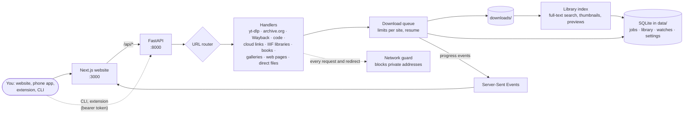

# How AnyGet works

AnyGet is two programs: a **FastAPI** server written in Python (the downloads, the library and
the database) and a **Next.js** website. The website talks to the server only through
`/api/*`; the command line, the browser extension and scripts use the same API.

## A link's journey

1. **Normalize.** The URL router trims the link, follows short links, and removes tracking
   parameters (`utm_*`, `fbclid`, `si`…).
2. **Route.** It picks the first handler that can take the link, in a fixed order: torrents,
   archive.org and the Wayback Machine, code hosts, cloud shares, IIIF libraries, AI
   resources, then anything yt-dlp supports, then galleries, and finally direct files and
   web pages. Plugins can add handlers.
3. **Probe.** The handler reports what is behind the link (title, size, thumbnail) and the
   choices: formats for a video, files for an archive item, pages for a library item.
4. **Queue.** You pick, and the job joins the queue (3 at a time by default, and fewer per
   site for archive.org and the big libraries). Partial files are kept as
   `.anyget-<job id>.part`, so a paused or interrupted download resumes, even after a
   restart.
5. **Download.** The handler downloads through AnyGet's network guard, verifies checksums
   when the site gives them, and saves the file under a safe name inside `downloads/`.
6. **Live progress.** Every change is sent to the website as a Server-Sent Event.
7. **Library.** Finished files are indexed: kind, thumbnail, and their text for full-text
   search.

## Safety built in

- **Network guard:** only `http`/`https`, and every request **and every redirect** is checked
  so a link can't make AnyGet reach your private network or a cloud metadata address.
  yt-dlp's own connections are guarded too.
- **Path safety:** file names are cleaned (keeping Japanese, Arabic, Devanagari…), and every
  path is checked to stay inside the downloads folder.
- **Legal rules:** no DRM, no shadow libraries, no getting around region blocks, paywalls or
  lending limits. These are enforced in the handlers, not just in the interface.
- **Access:** ports are bound to `127.0.0.1`. Anything reachable from the internet needs the
  owner sign-in, Cloudflare Access or a bearer token. Secrets are encrypted at rest and never
  logged or sent to the AI helper.
- **Separate programs:** gallery-dl (GPL) runs only as a separate process; FFmpeg only reads
  local files.

## Where the code lives

| Path | What it is |
|---|---|
| `apps/api/anyget/core/` | Settings, URL router, database, jobs and queue, events, file names, the network guard, sign-in |
| `apps/api/anyget/handlers/` | One file per kind of site; [CONTRIBUTING](../CONTRIBUTING.md#add-a-site) explains the contract |
| `apps/api/anyget/books/`, `libraries/`, `universal/` | Book sources and ranking, the library registry, universal search and Sections |
| `apps/api/anyget/library/`, `watch/`, `convert/` | The offline library (index, thumbnails, previews, cleanup), watches, conversion and OCR |
| `apps/api/anyget/api/`, `cli/` | The HTTP API and the `anyget` command line |
| `apps/web/` | The Next.js website (pages, components, translations in `messages/`) |
| `apps/extension/` | The browser extension |
| `packages/shared/` | The typed API client generated from the OpenAPI schema |

[CLAUDE.md](../CLAUDE.md) has the full rules and the gotchas for each part.
